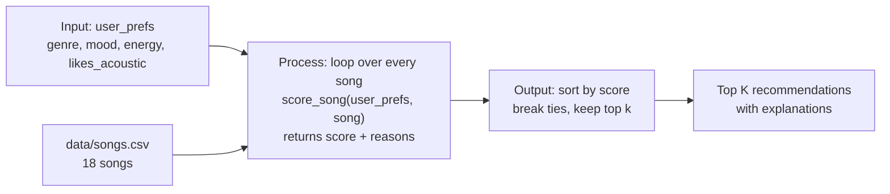

# 🎵 Music Recommender Simulation

## Project Summary

In this project you will build and explain a small music recommender system.

Your goal is to:

- Represent songs and a user "taste profile" as data
- Design a scoring rule that turns that data into recommendations
- Evaluate what your system gets right and wrong
- Reflect on how this mirrors real world AI recommenders

Replace this paragraph with your own summary of what your version does.

---

## How The System Works

Real-world platforms like Spotify and YouTube combine two approaches. **Collaborative filtering** recommends what similar listeners played ("people who liked A also liked B"), and **content-based filtering** recommends songs whose attributes, such as genre, mood or energy, match what you already like. They then rank the candidates with a model and adjust the final list for variety and freshness. My simulation uses only **content-based filtering**, because there's no data about other users. Each song is compared to one user's taste profile, and the system prioritizes **genre first, then mood, then how close the song's energy is to the user's target**, with a small bonus for matching the user's acoustic preference.

### Features used

**`Song`**
- `genre`: categorical, compared for an exact match
- `mood`: categorical, compared for an exact match
- `energy` (0–1): compared by closeness to the user's target
- `acousticness` (0–1): checked against the user's acoustic preference
- `tempo_bpm`, `valence`, `danceability`: loaded but not scored. Tempo and danceability are strongly correlated with energy in this dataset, so scoring them would mostly double-count energy. Valence is a good candidate to add later (see the biases below).
- `id`, `title`, `artist`: identifiers used for display

**`UserProfile`**
- `favorite_genre`: the genre the user prefers
- `favorite_mood`: the mood the user is looking for
- `target_energy` (0–1): the energy level the user wants
- `likes_acoustic` (True/False): whether the user prefers acoustic-sounding songs

**Example taste profile**

```python
user_prefs = {
    "genre": "pop",          # favorite_genre
    "mood": "happy",         # favorite_mood
    "energy": 0.8,           # target_energy
    "likes_acoustic": False,
}
```

This profile clearly separates "intense rock" from "chill lofi": Storm Runner (rock/intense) scores about 1.8 and Library Rain (lofi/chill) about 0.8. Neither matches genre or mood, though, so the gap comes entirely from energy and acousticness. The profile is narrow: exact genre matching gives "indie pop" no credit for being close to "pop".

### Algorithm recipe

**Scoring rule (one song):**

| Component | Points |
|---|---|
| Genre matches `favorite_genre` | +2.0 |
| Mood matches `favorite_mood` | +1.0 |
| Energy closeness | +1.5 × (1 − \|song.energy − target_energy\|) |
| Acoustic fit (acousticness ≥ 0.6 if `likes_acoustic`, ≤ 0.4 if not) | +0.5 |

The highest possible score is 5.0. Energy is scored by *closeness*, so a song slightly above or below the target scores well, and a song far from it in either direction scores poorly. Genre is weighted above mood because genre reflects long-term taste, while mood changes from moment to moment and partly overlaps with energy.

**Ranking rule (the whole list):** score every song, sort from highest to lowest, break ties by energy closeness, and return the top `k`. Each recommendation includes the reasons that earned it points, for example "genre match: pop" or "energy 0.82 is close to your target 0.80".

### Data flow



### Expected biases and limitations

- **Genre dominance:** a genre match (+2.0) is worth twice a mood match, so genre usually outweighs a better mood fit. A pop fan gets Gym Hero (pop/intense) ranked above Rooftop Lights (indie pop/happy), even though Rooftop Lights fits the requested mood.
- **Exact string matching:** related genres (pop vs. indie pop, rock vs. metal) and related moods (chill vs. relaxed, sad vs. melancholic) get no partial credit.
- **Energy decides everything after the first few picks:** most genres have only 1–3 songs, so once the matching songs are used up, the rest of the top 5 is ranked almost entirely by energy. In a test run, a chill lofi fan's 5th pick was Last Train Blues (blues/sad), because its energy was close. The system can't tell a calm, happy song from a calm, sad one unless valence is scored.
- **Small, hand-made catalog:** 18 songs, with uneven genre coverage (lofi has 3 songs, most genres have 1), so some users get much better matches than others.

---

## Getting Started

### Setup

1. Create a virtual environment (optional but recommended):

   ```bash
   python -m venv .venv
   source .venv/bin/activate      # Mac or Linux
   .venv\Scripts\activate         # Windows

2. Install dependencies

```bash
pip install -r requirements.txt
```

3. Run the app:

```bash
python -m src.main
```

### Running Tests

Run the starter tests with:

```bash
pytest
```

You can add more tests in `tests/test_recommender.py`.

---

## Sample Recommendation Output

Output of `python -m src.main` for the default pop/happy profile:

```
Loaded songs: 18

User profile: genre=pop, mood=happy, energy=0.8, likes_acoustic=False

Top recommendations:

1. Sunrise City by Neon Echo  (pop/happy)
   Score: 4.97 / 5.00
   - genre match: pop (+2.0)
   - mood match: happy (+1.0)
   - energy 0.82 vs target 0.80 (+1.47)
   - non-acoustic sound (0.18) (+0.5)

2. Gym Hero by Max Pulse  (pop/intense)
   Score: 3.80 / 5.00
   - genre match: pop (+2.0)
   - energy 0.93 vs target 0.80 (+1.30)
   - non-acoustic sound (0.05) (+0.5)

3. Rooftop Lights by Indigo Parade  (indie pop/happy)
   Score: 2.94 / 5.00
   - mood match: happy (+1.0)
   - energy 0.76 vs target 0.80 (+1.44)
   - non-acoustic sound (0.35) (+0.5)

4. Concrete Verses by Block Theory  (hip-hop/confident)
   Score: 1.97 / 5.00
   - energy 0.78 vs target 0.80 (+1.47)
   - non-acoustic sound (0.12) (+0.5)

5. Night Drive Loop by Neon Echo  (synthwave/moody)
   Score: 1.92 / 5.00
   - energy 0.75 vs target 0.80 (+1.42)
   - non-acoustic sound (0.22) (+0.5)
```

**Screenshot or video** *(optional)*: <!-- Insert a screenshot or demo video link here -->

---

## Experiments You Tried

Use this section to document the experiments you ran. For example:

- What happened when you changed the weight on genre from 2.0 to 0.5
- What happened when you added tempo or valence to the score
- How did your system behave for different types of users

---

## Limitations and Risks

Summarize some limitations of your recommender.

Examples:

- It only works on a tiny catalog
- It does not understand lyrics or language
- It might over favor one genre or mood

You will go deeper on this in your model card.

---

## Reflection

Read and complete `model_card.md`:

[**Model Card**](model_card.md)

Write 1 to 2 paragraphs here about what you learned:

- about how recommenders turn data into predictions
- about where bias or unfairness could show up in systems like this


