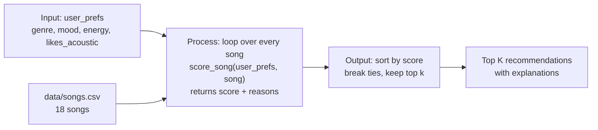

# 🎵 Music Recommender Simulation

## Project Summary

In this project you will build and explain a small music recommender system.

Your goal is to:

- Represent songs and a user "taste profile" as data
- Design a scoring rule that turns that data into recommendations
- Evaluate what your system gets right and wrong
- Reflect on how this mirrors real world AI recommenders

**My version, VibeMatch 1.0,** is a content-based recommender that runs in the terminal. It loads 18 songs from `data/songs.csv` and gives each song points for matching a user's favorite genre (+2.0) and mood (+1.0), for having energy close to the user's target (up to +1.5), and for fitting their acoustic preference (+0.5). It then returns the top 5 songs, each with the reasons it earned its points. I tested it with six user profiles, including edge cases designed to break it, ran a weight-shift experiment, and fixed a case-sensitivity bug the tests uncovered. The full evaluation is in the [model card](model_card.md).

---

## How The System Works

Real-world platforms like Spotify and YouTube combine two approaches. **Collaborative filtering** recommends what similar listeners played ("people who liked A also liked B"), and **content-based filtering** recommends songs whose attributes, such as genre, mood or energy, match what you already like. They then rank the candidates with a model and adjust the final list for variety and freshness. My simulation uses only **content-based filtering**, because there's no data about other users. Each song is compared to one user's taste profile, and the system prioritizes **genre first, then mood, then how close the song's energy is to the user's target**, with a small bonus for matching the user's acoustic preference.

### Features used

**`Song`**
- `genre`: categorical, compared for an exact match
- `mood`: categorical, compared for an exact match
- `energy` (0–1): compared by closeness to the user's target
- `acousticness` (0–1): checked against the user's acoustic preference
- `tempo_bpm`, `valence`, `danceability`: loaded but not scored. Tempo and danceability are strongly correlated with energy in this dataset, so scoring them would mostly double-count energy. Valence is a good candidate to add later (see the biases below).
- `id`, `title`, `artist`: identifiers used for display

**`UserProfile`**
- `favorite_genre`: the genre the user prefers
- `favorite_mood`: the mood the user is looking for
- `target_energy` (0–1): the energy level the user wants
- `likes_acoustic` (True/False): whether the user prefers acoustic-sounding songs

**Example taste profile**

```python
user_prefs = {
    "genre": "pop",          # favorite_genre
    "mood": "happy",         # favorite_mood
    "energy": 0.8,           # target_energy
    "likes_acoustic": False,
}
```

This profile clearly separates "intense rock" from "chill lofi": Storm Runner (rock/intense) scores about 1.8 and Library Rain (lofi/chill) about 0.8. Neither matches genre or mood, though, so the gap comes entirely from energy and acousticness. The profile is narrow: exact genre matching gives "indie pop" no credit for being close to "pop".

### Algorithm recipe

**Scoring rule (one song):**

| Component | Points |
|---|---|
| Genre matches `favorite_genre` | +2.0 |
| Mood matches `favorite_mood` | +1.0 |
| Energy closeness | +1.5 × (1 − \|song.energy − target_energy\|) |
| Acoustic fit (acousticness ≥ 0.6 if `likes_acoustic`, ≤ 0.4 if not) | +0.5 |

The highest possible score is 5.0. Energy is scored by *closeness*, so a song slightly above or below the target scores well, and a song far from it in either direction scores poorly. Genre is weighted above mood because genre reflects long-term taste, while mood changes from moment to moment and partly overlaps with energy.

**Ranking rule (the whole list):** score every song, sort from highest to lowest, break ties by energy closeness, and return the top `k`. Each recommendation includes the reasons that earned it points, for example "genre match: pop" or "energy 0.82 is close to your target 0.80".

### Data flow



### Expected biases and limitations

- **Genre dominance:** a genre match (+2.0) is worth twice a mood match, so genre usually outweighs a better mood fit. A pop fan gets Gym Hero (pop/intense) ranked above Rooftop Lights (indie pop/happy), even though Rooftop Lights fits the requested mood.
- **Exact string matching:** related genres (pop vs. indie pop, rock vs. metal) and related moods (chill vs. relaxed, sad vs. melancholic) get no partial credit.
- **Energy decides everything after the first few picks:** most genres have only 1–3 songs, so once the matching songs are used up, the rest of the top 5 is ranked almost entirely by energy. In a test run, a chill lofi fan's 5th pick was Last Train Blues (blues/sad), because its energy was close. The system can't tell a calm, happy song from a calm, sad one unless valence is scored.
- **Small, hand-made catalog:** 18 songs, with uneven genre coverage (lofi has 3 songs, most genres have 1), so some users get much better matches than others.

---

## Getting Started

### Setup

1. Create a virtual environment (optional but recommended):

   ```bash
   python -m venv .venv
   source .venv/bin/activate      # Mac or Linux
   .venv\Scripts\activate         # Windows

2. Install dependencies

```bash
pip install -r requirements.txt
```

3. Run the app:

```bash
python -m src.main
```

### Running Tests

Run the starter tests with:

```bash
pytest
```

You can add more tests in `tests/test_recommender.py`.

---

## Sample Recommendation Output

Output of `python -m src.main` for the default pop/happy profile:

```
Loaded songs: 18

User profile: genre=pop, mood=happy, energy=0.8, likes_acoustic=False

Top recommendations:

1. Sunrise City by Neon Echo  (pop/happy)
   Score: 4.97 / 5.00
   - genre match: pop (+2.0)
   - mood match: happy (+1.0)
   - energy 0.82 vs target 0.80 (+1.47)
   - non-acoustic sound (0.18) (+0.5)

2. Gym Hero by Max Pulse  (pop/intense)
   Score: 3.80 / 5.00
   - genre match: pop (+2.0)
   - energy 0.93 vs target 0.80 (+1.30)
   - non-acoustic sound (0.05) (+0.5)

3. Rooftop Lights by Indigo Parade  (indie pop/happy)
   Score: 2.94 / 5.00
   - mood match: happy (+1.0)
   - energy 0.76 vs target 0.80 (+1.44)
   - non-acoustic sound (0.35) (+0.5)

4. Concrete Verses by Block Theory  (hip-hop/confident)
   Score: 1.97 / 5.00
   - energy 0.78 vs target 0.80 (+1.47)
   - non-acoustic sound (0.12) (+0.5)

5. Night Drive Loop by Neon Echo  (synthwave/moody)
   Score: 1.92 / 5.00
   - energy 0.75 vs target 0.80 (+1.42)
   - non-acoustic sound (0.22) (+0.5)
```

**Screenshot or video** *(optional)*: <!-- Insert a screenshot or demo video link here -->

---

## Experiments You Tried

### Stress test: six user profiles

`python -m src.main` runs three normal profiles and three edge cases designed to trick the scoring. The analysis is in [model_card.md](model_card.md#7-evaluation).

```
============================================================
Profile: High-Energy Pop
genre=pop, mood=happy, energy=0.85, likes_acoustic=False
============================================================
1. Sunrise City by Neon Echo  (pop/happy)
   Score: 4.96 / 5.00
   - genre match: pop (+2.0)
   - mood match: happy (+1.0)
   - energy 0.82 vs target 0.85 (+1.46)
   - non-acoustic sound (0.18) (+0.5)
2. Gym Hero by Max Pulse  (pop/intense)
   Score: 3.88 / 5.00
   - genre match: pop (+2.0)
   - energy 0.93 vs target 0.85 (+1.38)
   - non-acoustic sound (0.05) (+0.5)
3. Rooftop Lights by Indigo Parade  (indie pop/happy)
   Score: 2.87 / 5.00
   - mood match: happy (+1.0)
   - energy 0.76 vs target 0.85 (+1.36)
   - non-acoustic sound (0.35) (+0.5)
4. Storm Runner by Voltline  (rock/intense)
   Score: 1.91 / 5.00
   - energy 0.91 vs target 0.85 (+1.41)
   - non-acoustic sound (0.10) (+0.5)
5. Concrete Verses by Block Theory  (hip-hop/confident)
   Score: 1.90 / 5.00
   - energy 0.78 vs target 0.85 (+1.40)
   - non-acoustic sound (0.12) (+0.5)
```

```
============================================================
Profile: Chill Lofi
genre=lofi, mood=chill, energy=0.35, likes_acoustic=True
============================================================
1. Library Rain by Paper Lanterns  (lofi/chill)
   Score: 5.00 / 5.00
   - genre match: lofi (+2.0)
   - mood match: chill (+1.0)
   - energy 0.35 vs target 0.35 (+1.50)
   - acoustic sound (0.86) (+0.5)
2. Midnight Coding by LoRoom  (lofi/chill)
   Score: 4.89 / 5.00
   - genre match: lofi (+2.0)
   - mood match: chill (+1.0)
   - energy 0.42 vs target 0.35 (+1.40)
   - acoustic sound (0.71) (+0.5)
3. Focus Flow by LoRoom  (lofi/focused)
   Score: 3.92 / 5.00
   - genre match: lofi (+2.0)
   - energy 0.40 vs target 0.35 (+1.42)
   - acoustic sound (0.78) (+0.5)
4. Spacewalk Thoughts by Orbit Bloom  (ambient/chill)
   Score: 2.90 / 5.00
   - mood match: chill (+1.0)
   - energy 0.28 vs target 0.35 (+1.40)
   - acoustic sound (0.92) (+0.5)
5. Coffee Shop Stories by Slow Stereo  (jazz/relaxed)
   Score: 1.97 / 5.00
   - energy 0.37 vs target 0.35 (+1.47)
   - acoustic sound (0.89) (+0.5)
```

```
============================================================
Profile: Deep Intense Rock
genre=rock, mood=intense, energy=0.92, likes_acoustic=False
============================================================
1. Storm Runner by Voltline  (rock/intense)
   Score: 4.98 / 5.00
   - genre match: rock (+2.0)
   - mood match: intense (+1.0)
   - energy 0.91 vs target 0.92 (+1.48)
   - non-acoustic sound (0.10) (+0.5)
2. Gym Hero by Max Pulse  (pop/intense)
   Score: 2.98 / 5.00
   - mood match: intense (+1.0)
   - energy 0.93 vs target 0.92 (+1.48)
   - non-acoustic sound (0.05) (+0.5)
3. Bassline Fever by Pulse Theory  (edm/energetic)
   Score: 1.96 / 5.00
   - energy 0.95 vs target 0.92 (+1.46)
   - non-acoustic sound (0.04) (+0.5)
4. Iron Requiem by Grave Circuit  (metal/angry)
   Score: 1.93 / 5.00
   - energy 0.97 vs target 0.92 (+1.43)
   - non-acoustic sound (0.03) (+0.5)
5. Sunrise City by Neon Echo  (pop/happy)
   Score: 1.85 / 5.00
   - energy 0.82 vs target 0.92 (+1.35)
   - non-acoustic sound (0.18) (+0.5)
```

```
============================================================
Profile: Conflicting: Sad but High-Energy
genre=blues, mood=sad, energy=0.9, likes_acoustic=True
============================================================
1. Last Train Blues by Hollow Pine  (blues/sad)
   Score: 4.22 / 5.00
   - genre match: blues (+2.0)
   - mood match: sad (+1.0)
   - energy 0.38 vs target 0.90 (+0.72)
   - acoustic sound (0.75) (+0.5)
2. Storm Runner by Voltline  (rock/intense)
   Score: 1.48 / 5.00
   - energy 0.91 vs target 0.90 (+1.48)
3. Dust Road Home by Willow Creek  (country/nostalgic)
   Score: 1.48 / 5.00
   - energy 0.55 vs target 0.90 (+0.98)
   - acoustic sound (0.65) (+0.5)
4. Gym Hero by Max Pulse  (pop/intense)
   Score: 1.46 / 5.00
   - energy 0.93 vs target 0.90 (+1.46)
5. Bassline Fever by Pulse Theory  (edm/energetic)
   Score: 1.43 / 5.00
   - energy 0.95 vs target 0.90 (+1.43)
```

```
============================================================
Profile: Unknown Genre (k-pop)
genre=k-pop, mood=happy, energy=0.7, likes_acoustic=False
============================================================
1. Rooftop Lights by Indigo Parade  (indie pop/happy)
   Score: 2.91 / 5.00
   - mood match: happy (+1.0)
   - energy 0.76 vs target 0.70 (+1.41)
   - non-acoustic sound (0.35) (+0.5)
2. Sunrise City by Neon Echo  (pop/happy)
   Score: 2.82 / 5.00
   - mood match: happy (+1.0)
   - energy 0.82 vs target 0.70 (+1.32)
   - non-acoustic sound (0.18) (+0.5)
3. Night Drive Loop by Neon Echo  (synthwave/moody)
   Score: 1.92 / 5.00
   - energy 0.75 vs target 0.70 (+1.42)
   - non-acoustic sound (0.22) (+0.5)
4. Concrete Verses by Block Theory  (hip-hop/confident)
   Score: 1.88 / 5.00
   - energy 0.78 vs target 0.70 (+1.38)
   - non-acoustic sound (0.12) (+0.5)
5. Velvet Hours by Amara Lane  (r&b/romantic)
   Score: 1.70 / 5.00
   - energy 0.50 vs target 0.70 (+1.20)
   - non-acoustic sound (0.40) (+0.5)
```

*Capitalized Input, as first run, before the case-sensitivity fix:*

```
============================================================
Profile: Capitalized Input (Pop/Happy)
genre=Pop, mood=Happy, energy=0.85, likes_acoustic=False
============================================================
1. Sunrise City by Neon Echo  (pop/happy)
   Score: 1.96 / 5.00
   - energy 0.82 vs target 0.85 (+1.46)
   - non-acoustic sound (0.18) (+0.5)
2. Storm Runner by Voltline  (rock/intense)
   Score: 1.91 / 5.00
   - energy 0.91 vs target 0.85 (+1.41)
   - non-acoustic sound (0.10) (+0.5)
3. Concrete Verses by Block Theory  (hip-hop/confident)
   Score: 1.90 / 5.00
   - energy 0.78 vs target 0.85 (+1.40)
   - non-acoustic sound (0.12) (+0.5)
4. Gym Hero by Max Pulse  (pop/intense)
   Score: 1.88 / 5.00
   - energy 0.93 vs target 0.85 (+1.38)
   - non-acoustic sound (0.05) (+0.5)
5. Rooftop Lights by Indigo Parade  (indie pop/happy)
   Score: 1.86 / 5.00
   - energy 0.76 vs target 0.85 (+1.36)
   - non-acoustic sound (0.35) (+0.5)
```

This run showed that "Pop" and "Happy" earned no genre or mood points. After I made matching case-insensitive, this profile returns exactly the same top 5 as High-Energy Pop (Sunrise City 4.96, Gym Hero 3.88, Rooftop Lights 2.87, Storm Runner 1.91, Concrete Verses 1.90).

### Weight shift: energy doubled, genre halved

I changed `GENRE_POINTS` from 2.0 to 1.0 and `ENERGY_POINTS` from 1.5 to 3.0, which raises the maximum score from 5.0 to 5.5. The math stays valid because energy closeness is still between 0 and 1 before weighting.

| Profile | Top 5 before | Top 5 after |
|---|---|---|
| High-Energy Pop | Sunrise City, Gym Hero, Rooftop Lights, Storm Runner, Concrete Verses | **Same order** (Rooftop Lights now 4.23 vs. Gym Hero 4.26, almost tied) |
| Chill Lofi | Library Rain, Midnight Coding, Focus Flow, Spacewalk Thoughts, Coffee Shop Stories | **Same order** |
| Deep Intense Rock | Storm Runner, Gym Hero, Bassline Fever, Iron Requiem, Sunrise City | **Same order** |
| Sad but High-Energy | Last Train Blues, Storm Runner, Dust Road Home, Gym Hero, Bassline Fever | Dust Road Home (energy 0.55) drops out; Iron Requiem (energy 0.97) comes in |

**Result: different scores, almost the same rankings, so not clearly more accurate.** In this catalog, genre and energy point the same way: pop and rock songs are high-energy, and lofi songs are low-energy. Changing the balance between them rarely changes the order. The only visible effect is that gaps shrink: for the pop fan, Rooftop Lights (the "happy" song) nearly catches Gym Hero. I kept the original weights.

---

## Limitations and Risks

- **Tiny catalog:** 18 made-up songs, and most genres and moods have only one song. A typical user matches 1–3 songs exactly, and the rest of the top 5 is ranked mostly by energy.
- **Energy-only fallback:** a "sad but high-energy" user gets their one sad song, followed by intense rock and gym pop, because the system has nothing else sad to offer.
- **Genre outweighs mood:** Gym Hero (pop/intense) beats Rooftop Lights (indie pop/happy) for a "happy pop" fan, because "indie pop" gets no credit for being close to "pop".
- **No partial matches:** related genres and moods (rock and metal, chill and relaxed) are treated as completely different.
- **Missing features:** valence, tempo and danceability aren't scored, and the system doesn't know lyrics, language or listening history.

More detail is in the [model card](model_card.md#6-limitations-and-bias).

---

## Reflection

Read and complete `model_card.md`:

[**Model Card**](model_card.md)

Write 1 to 2 paragraphs here about what you learned:

- about how recommenders turn data into predictions
- about where bias or unfairness could show up in systems like this


